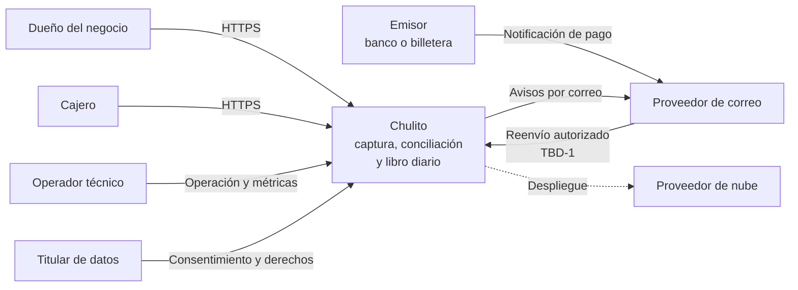
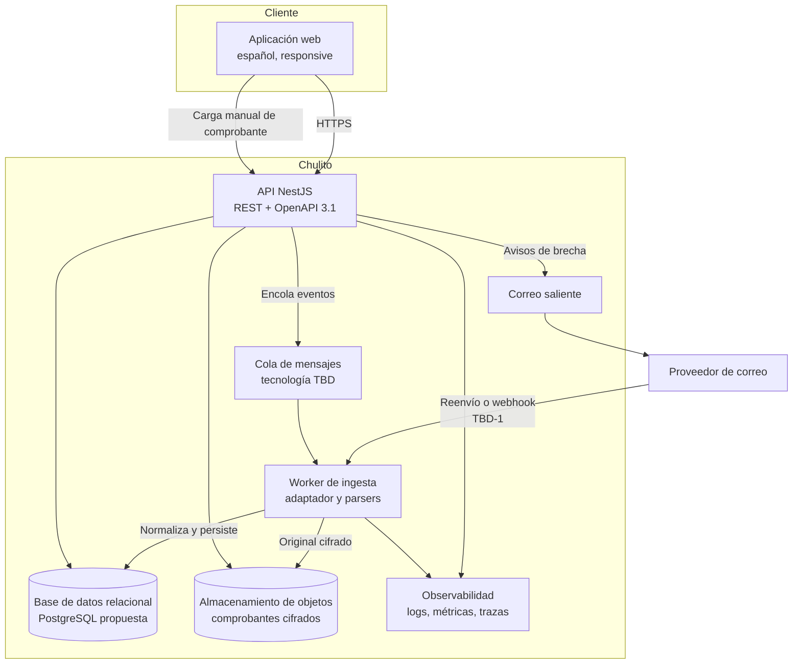
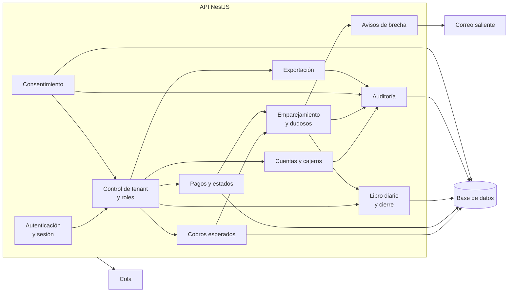
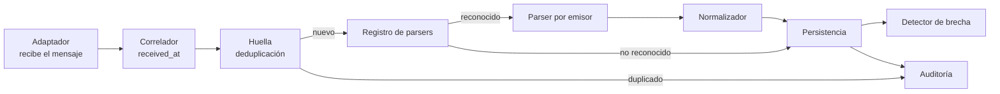
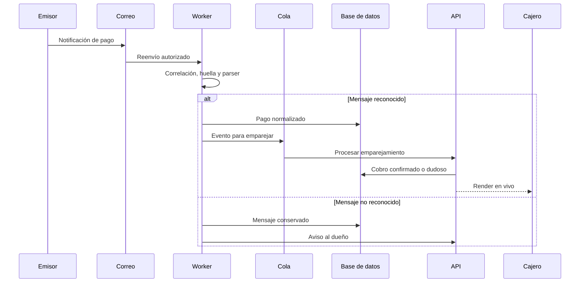
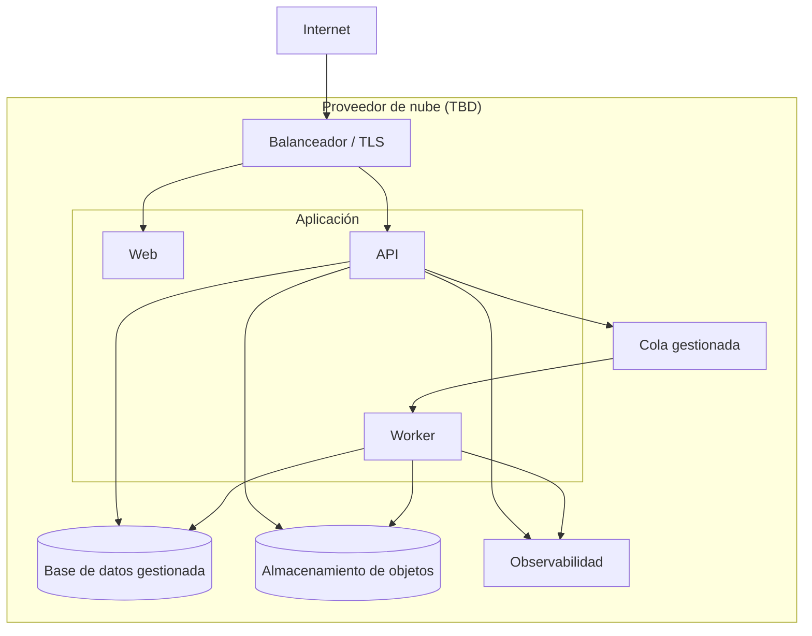

# Modelo C4

**Chulito — confirmación compartida de pagos y libro diario para negocios pequeños**

> **BORRADOR (v0.1).** Modelo de arquitectura **propuesto**. El backend de producción no existe (TBD-9): los contenedores y componentes describen el diseño objetivo, no un sistema desplegado. Las tecnologías marcadas como *TBD* no están decididas. Los diagramas se renderizan en GitHub; en el PDF se incluyen como imagen.

| Campo | Valor |
|---|---|
| Versión | 0.1 (borrador) |
| Fecha | 4 de noviembre de 2026 |
| Estado | Borrador — pendiente de revisión de arquitectura |
| Fuentes | SRS v0.4 §2, §8, §9; ADR-0001; modelo STRIDE; historias de usuario |
| Nivel C4 | Contexto (L1), contenedores (L2) y componentes (L3). Código (L4) fuera de alcance |

## 1. Propósito y alcance

Este documento describe **qué componentes existen, qué responsabilidad tiene cada uno y cómo se comunican**, antes de decidir el modelo de datos y el contrato OpenAPI.

**Incluye:** contexto del sistema, contenedores, componentes internos de la API y del worker, flujo de captura y límites de confianza.

**No incluye:** clases, tablas, endpoints concretos, tecnología de cola, ORM, proveedor de nube ni autenticación de terceros. Esas decisiones quedan para documentos posteriores o para ADR.

## 2. Restricciones que condicionan el diseño

1. **Un solo desarrollador.** La arquitectura debe ser operable por una persona.
2. **Sin API oficial de bancos.** La captura depende de una vía que controla el usuario (TBD-1).
3. **No se custodian ni se mueven fondos.** Chulito no es entidad financiera.
4. **Multi-tenant.** Todo dato pertenece a un negocio y el aislamiento es un requisito (`SRS-F-05`, `SRS-NFR-06`).
5. **Tiempo real percibido.** p95 ≤ 10 s desde la captura hasta el render (`SRS-NFR-01`).
6. **Idempotencia.** Un mensaje repetido no puede crear un segundo pago (`SRS-F-13`).
7. **Nunca inventar pagos.** Una brecha o un canal caído no se convierte en pago (`SRS-F-10`, `SRS-F-15`).
8. **Stack objetivo.** NestJS + TypeScript/ESM según ADR-0001; Node 24 LTS.
9. **Sin datos reales** en desarrollo ni en el repositorio.

## 3. Nivel 1 — Contexto del sistema

### 3.1 Diagrama

### 3.2 Actores y sistemas externos

| Elemento | Tipo | Relación |
|---|---|---|
| Dueño | Persona | Controla negocio, cajeros, captura, consentimiento y exportación |
| Cajero | Persona | Registra cobros y ve pagos de su negocio |
| Operador técnico | Persona | Opera el servicio y ve métricas sin contenido de pagos |
| Titular de datos | Persona | Otorga o revoca consentimiento y ejerce derechos |
| Emisor | Sistema externo | Banco o billetera que envía la notificación al correo del usuario |
| Proveedor de correo | Sistema externo | Transporta la notificación y los avisos de Chulito |
| Proveedor de nube | Sistema externo | Infraestructura donde se despliega Chulito |
| Chulito | Sistema | Captura, normaliza, concilia y registra los pagos |

**Límite importante:** Chulito **no** se conecta al banco. El emisor notifica al usuario y el usuario (o su filtro) reenvía la notificación. Esa decisión es TBD-1 y hoy no está cerrada.

## 4. Nivel 2 — Contenedores

### 4.1 Diagrama

### 4.2 Responsabilidades

| Contenedor | Responsabilidad | Datos que toca | Protocolo |
|---|---|---|---|
| Aplicación web | Interfaz de dueño y cajero; estado del canal, cobros, pagos, libro y exportación | Datos de la sesión y de la vista | HTTPS |
| API NestJS | Autenticación, autorización por tenant, reglas de negocio, consultas y avisos | Todo el dominio, según permisos | HTTPS / JSON, OpenAPI 3.1 |
| Worker de ingesta | Recibir, correlacionar, deduplicar, parsear y normalizar notificaciones | Mensajes crudos y pagos normalizados | Cola |
| Cola de mensajes | Desacoplar recepción de procesamiento y permitir reintentos | Eventos con correlación y huella | TBD |
| Base de datos | Estado del dominio: negocios, usuarios, cobros, pagos, consentimientos, auditoría | Datos estructurados | SQL |
| Almacenamiento de objetos | Guardar el comprobante original cifrado | Archivos y cuerpos de correo | TBD |
| Correo saliente | Enviar avisos de brecha e incidencias | Correo del dueño y contenido del aviso | SMTP o API |
| Observabilidad | Logs sin PII, métricas de captura y trazas correlacionadas | Metadatos técnicos | TBD |

### 4.3 Decisiones pendientes en este nivel

| Tema | Estado | Por qué no se decide aquí |
|---|---|---|
| Canal de captura (correo reenviado, webhook o carga manual) | **TBD-1** | Requiere prueba real y ADR |
| Tecnología de cola | TBD | Depende del volumen y del proveedor de nube |
| PostgreSQL como base definitiva | Propuesta | ADR-0001 no ejecutó conexión real |
| ORM o acceso a datos | TBD | Se decide con el modelo de datos |
| Tiempo real (SSE, WebSocket o sondeo) | TBD | Se decide con el contrato de API |
| Proveedor de nube y región | TBD | Afecta transferencia internacional (TBD-6) |
| Autenticación (propia o proveedor) | TBD | Afecta MFA y coste |

## 5. Nivel 3 — Componentes de la API

| Componente | Responsabilidad | Requisitos |
|---|---|---|
| Autenticación y sesión | Iniciar y cerrar sesión, expirar por inactividad, revocar dispositivos | `SRS-F-02`, `SRS-NFR-05` |
| Control de tenant y roles | Resolver el negocio de cada solicitud y aplicar permisos; rechazar accesos cruzados | `SRS-F-04`, `SRS-F-05`, `SRS-RN-05` |
| Cuentas y cajeros | Alta de negocio, invitación y revocación de cajeros | `SRS-F-01`, `SRS-F-03` |
| Cobros esperados | Registrar y consultar cobros con monto y referencia opcional | `SRS-F-21`, `SRS-F-23` |
| Pagos y estados | Exponer pagos normalizados y sus estados sin inventarlos | `SRS-F-20`, `SRS-F-24` |
| Emparejamiento y dudosos | Aplicar la ventana, marcar dudosos y permitir resolución del dueño | `SRS-F-22`, `SRS-F-25`, `SRS-RN-02`, `SRS-RN-03` |
| Libro diario y cierre | Agrupar por negocio, fecha, emisor y cajero; cerrar en `America/Bogota` | `SRS-F-30`, `SRS-F-31`, `SRS-RN-06` |
| Consentimiento | Registrar, consultar y revocar captura y avisos por separado | `SRS-F-10`, `SRS-NFR-07` |
| Auditoría | Registrar acciones sensibles de forma append-only | `SRS-F-40` |
| Exportación | Generar CSV/JSON solo del tenant, con filtros y auditoría | `SRS-F-32`, `SRS-F-41` |
| Avisos de brecha | Enviar in-app y correo cuando hay consentimiento | `SRS-F-15`, `SRS-NFR-07` |

## 6. Nivel 3 — Componentes del worker

| Componente | Responsabilidad | Requisitos |
|---|---|---|
| Adaptador | Recibir el mensaje por el canal definido y marcarlo como aceptado | `SRS-F-10` |
| Correlador | Asignar identificador y `received_at` al inicio de la medición | `SRS-NFR-01`, `SRS-NFR-11` |
| Huella | Calcular hash y descartar duplicados de forma idempotente | `SRS-F-13` |
| Registro de parsers | Elegir el parser por emisor y conservar lo no reconocido | `SRS-F-11`, `SRS-F-14` |
| Parser por emisor | Extraer monto, referencia, fecha y tipo del mensaje | `SRS-F-12`, `SRS-NFR-09` |
| Normalizador | Unificar formato y separar `occurred_at` de `received_at` | `SRS-F-12` |
| Persistencia | Guardar mensaje crudo cifrado y pago normalizado | `SRS-NFR-07` |
| Detector de brecha | Observar señales de pérdida o retraso y registrar brecha | `SRS-F-15`, `SRS-NFR-04` |
| Auditoría | Registrar recepción, duplicado, no reconocido y brecha | `SRS-F-40` |

## 7. Flujo de captura y confirmación

**Regla del flujo:** si el canal está caído o el mensaje no llega, **no se crea un pago**. Solo se registra la brecha potencial y se avisa si hay consentimiento.

## 8. Límites de confianza y seguridad

| Frontera | Qué cruza | Control |
|---|---|---|
| Navegador → API | Credenciales, acciones y consultas | TLS, sesión, CSRF, autorización por tenant |
| Correo → Worker | Contenido no confiable | Validación de remitente, SPF/DKIM/DMARC, tamaño y tipo |
| Worker → Base de datos | Mensajes y pagos | Cifrado en tránsito, mínimo privilegio |
| API → Almacenamiento | Comprobantes | Cifrado en reposo, acceso privado |
| Operador → Plataforma | Métricas y estado | Sin acceso al contenido; auditoría de accesos |
| API → Correo saliente | Avisos | Solo con consentimiento; sin datos innecesarios |

| Amenaza STRIDE | Componente afectado | Mitigación de diseño |
|---|---|---|
| Suplantación del canal (S-02) | Adaptador | Remitentes autorizados, alias rotable, verificación de correo |
| Alteración de comprobante (T-01) | Parser y persistencia | Hash del original, extracción del adjunto, contraste |
| Reutilización (T-02) | Huella | Deduplicación global por hash, emisor, referencia y monto |
| Fuga entre negocios (I-01) | Control de tenant | Filtro obligatorio por negocio en cada consulta |
| Inyección en el parser (T-06) | Parser | Contenido como dato, esquema estricto, sin herramientas |
| Inundación (D-01/D-03) | Adaptador y API | Cuotas por negocio, límites de tasa, contrapresión |
| Escalada de privilegios (E-01) | Control de roles | Autorización en servidor, pruebas negativas |

## 9. Despliegue propuesto

**Supuestos:** una sola región, contenedores reproducibles según ADR-0001, base gestionada con copias cifradas y almacenamiento privado. La región y el proveedor afectan la transferencia internacional y deben confirmarse con la revisión legal (TBD-6).

## 10. Qué no decide este documento

- El esquema de base de datos y las tablas (siguiente documento).
- Los endpoints y sus códigos (contrato OpenAPI, posterior).
- La tecnología de cola, tiempo real, ORM o autenticación.
- El proveedor de nube, la región y el país de alojamiento.
- La vía definitiva de captura (TBD-1) y los emisores incluidos (TBD-2).
- La retención concreta (TBD-4) y la calificación legal de Chulito (TBD-6).

## 11. Riesgos de la arquitectura propuesta

| Riesgo | Impacto | Mitigación |
|---|---|---|
| Dependencia del correo como canal | Pérdida o suplantación de notificaciones | Validación de remitente, segundo canal, revisión manual |
| Un solo desarrollador | Complejidad operativa | Servicios gestionados y pocos contenedores |
| Parser frágil ante cambios del emisor | Pagos no reconocidos | Registro de no reconocidos, versionado de parsers y pruebas por emisor |
| Latencia del procesamiento | Cajero no ve el pago a tiempo | Cola con prioridad, métricas y p95 medido (NFR-01) |
| Aislamiento incompleto | Fuga entre negocios | Filtro por tenant en la capa de datos y pruebas automáticas |
| Costo de procesamiento | Abuso de extracción | Cuotas por negocio y presupuesto |

## 12. Próximos pasos

1. Revisar este modelo con el responsable técnico y corregir contenedores.
2. Derivar el **modelo de datos** de las entidades del SRS §9.
3. Escribir el **contrato OpenAPI 3.1** con tenant, correlación y errores de canal.
4. Actualizar el modelo STRIDE sobre esta arquitectura concreta.
5. Convertir el ADR-0001 en baseline aprobado antes de implementar.
